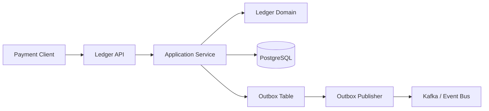

# Payment Ledger Platform

Payment Ledger Platform is a backend engineering showcase for a double-entry ledger, idempotent payment posting, settlement reconciliation, and event-driven financial workflows.

This repository is designed to demonstrate senior backend engineering skills: correctness, transaction boundaries, domain modeling, reliability, observability, and system design for money movement.

## What This Shows

- Double-entry accounting rules with explicit debit and credit legs
- Idempotency keys for retry-safe payment APIs
- Clean architecture boundaries between API, application, domain, and infrastructure
- Settlement and reconciliation concepts without depending on any employer-specific knowledge
- PostgreSQL persistence model with audit-friendly append-only records
- Event outbox pattern for reliable downstream publishing
- Tests for domain invariants that must never regress

## Core Use Cases

- Post a payment authorization or capture into the ledger
- Reject unbalanced journal entries
- Prevent duplicate posting during client retries
- Query account balances from immutable ledger lines
- Track settlement batches and reconciliation exceptions
- Publish ledger events after commit through an outbox

## Architecture



## Tech Stack

- Java 21
- Spring Boot 3
- Maven
- PostgreSQL
- Flyway migrations
- JUnit 5
- Docker Compose
- GitHub Actions

## Repository Layout

```text
src/main/java/com/gratycodes/ledger/
  api/            HTTP controllers and request DTOs
  application/    use cases and transaction orchestration
  domain/         ledger entities, value objects, invariants
  infra/          persistence and outbox adapters
docs/
  adr/            architecture decisions
infra/            local infrastructure
```

## Quick Start

```bash
docker compose -f infra/docker-compose.yml up -d
mvn test
mvn spring-boot:run
```

## Example API

```http
POST /ledger/journal-entries
Idempotency-Key: capture_123
Content-Type: application/json

{
  "reference": "payment_capture_123",
  "currency": "EUR",
  "lines": [
    { "accountId": "merchant_cash", "direction": "DEBIT", "amountMinor": 1999 },
    { "accountId": "platform_payable", "direction": "CREDIT", "amountMinor": 1999 }
  ]
}
```

## Engineering Notes

- Money is represented in minor units to avoid floating-point errors.
- Ledger entries are immutable after posting.
- A journal entry must balance per currency before it can be accepted.
- Idempotency is treated as part of the business contract, not middleware decoration.
- Outbox records are written in the same transaction as ledger entries.

## Roadmap

- [x] Domain model and balance invariants
- [x] API and application service skeleton
- [x] PostgreSQL schema and Docker Compose
- [x] CI workflow
- [ ] Repository implementation with jOOQ or Spring Data JDBC
- [ ] Reconciliation batch workflow
- [ ] Outbox publisher with retry and dead-letter tracking
- [ ] Load test script for posting throughput

